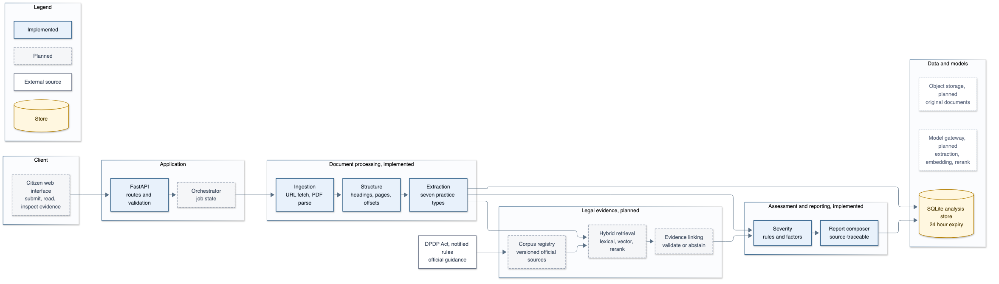

# Legal Analysis

Evidence-preserving analysis of privacy policies and terms documents under India's
Digital Personal Data Protection Act, 2023.

The system reads a policy supplied as a public URL, a PDF, or a curated corpus source,
preserves exact source locations, extracts structured data-practice statements, assigns
a transparent user-impact severity, and returns a report that can be audited line by
line.

The corpus contains the DPDP Act 2023 and three real privacy policies: Google, Eternal
(formerly Zomato) and TikTok. See [`corpus/README.md`](corpus/README.md).



The full architecture, the UML class model and the design rationale are in
[`docs/architecture.md`](docs/architecture.md).

It deliberately does **not** issue legal conclusions. The official DPDP corpus and
evidence-linking layer are the next milestone; until they exist, every observation
carries `legal_mapping_status: "not_available"`.

## What is implemented

| Capability | Status |
|---|---|
| Curated corpus with structural indices | Implemented: 1 statute, 3 policies |
| Public URL ingestion (HTML and PDF) | Implemented, SSRF guarded |
| PDF upload ingestion | Implemented |
| Canonical text with page, section and character offsets | Implemented |
| Deterministic sentence-level practice extraction | Implemented |
| Data-category detection | Implemented |
| User-impact severity rubric with factors | Implemented |
| Evidence-strength heuristic | Implemented |
| Ephemeral analysis storage and expiry | Implemented, SQLite |
| Report API with create/read/delete | Implemented |
| Official DPDP corpus retrieval | Not yet |
| Legal evidence linking | Not yet |
| Model-based extraction | Not yet |
| Frontend | Not yet |
| OCR for scanned PDFs | Not yet |

## Quickstart

Requires Python 3.12 and [uv](https://docs.astral.sh/uv/).

```bash
uv sync
uv run uvicorn app.main:app --reload
```

Interactive API documentation is then at <http://127.0.0.1:8000/docs>.

List the corpus and analyse a real policy:

```bash
curl -s http://127.0.0.1:8000/v1/corpus

curl -s -X POST http://127.0.0.1:8000/v1/analyses/corpus/zomato-privacy
```

Run the command-line analyser without starting the server:

```bash
uv run python -m app.cli --list-corpus
uv run python -m app.cli --corpus zomato-privacy --no-store
```

Run the checks:

```bash
uv run pytest
uv run ruff check .
```

## API

| Method | Path | Purpose |
|---|---|---|
| `GET` | `/health` | Liveness |
| `GET` | `/v1/corpus` | List curated corpus sources |
| `POST` | `/v1/analyses/corpus/{slug}` | Analyse a corpus source |
| `POST` | `/v1/analyses/pdf` | Analyse an uploaded PDF |
| `POST` | `/v1/analyses/url` | Analyse a public policy URL |
| `GET` | `/v1/analyses/{id}` | Retrieve a report |
| `DELETE` | `/v1/analyses/{id}` | Delete a report immediately |

Configuration:

| Variable | Default | Meaning |
|---|---|---|
| `LEGAL_ANALYSIS_DB` | `./legal_analysis.sqlite3` | Analysis store path |
| `ANALYSIS_RETENTION_HOURS` | `24` | Report lifetime |

## How a report is produced

```text
URL, PDF or corpus source
   |
   v
ingestion      canonical text + blocks (page, section, heading flag, offsets)
   |
   v
extraction     one dominant practice per sentence, with a verbatim quote
   |
   v
severity       rule-based user-impact level + factors
   |
   v
report         persisted, expiry-bound, source-traceable
```

Three invariants are enforced in code and tests:

1. Every observation contains at least one source span.
2. Every source span is an exact substring of the canonical document text.
3. Heading blocks never become observations, and document text is never treated as
   an instruction.

## Design decisions

**Sentence-level decision list instead of token windows.** A policy sentence usually
describes one practice. Classifying each sentence by a prioritised cue list avoids
reporting a sharing clause as data collection merely because it contains the word
"process". The quote is the whole sentence, so a reviewer can verify it directly.

**User-impact severity is separate from legal analysis.** Severity answers "how much
could this practice matter to a person", not "is this lawful". The rubric is a small
set of explicit rules, so every score can be explained and corrected.

**Evidence strength is a separate field.** It describes how much context the extracted
statement provides. It is not a probability and not a legal sufficiency measure.

**Ephemeral by default.** Reports carry an expiry timestamp, expired rows are removed
at startup and on demand, and deletion is immediate. Document text is not written to
logs.

**SQLite behind a narrow store interface.** The prototype needs no infrastructure.
The interface is small enough to replace with PostgreSQL and `pgvector` when the
official corpus and retrieval layer arrive.

**URL fetching is treated as hostile input.** Only HTTP(S), no credentials, standard
ports, public DNS results and public peer addresses, bounded redirects, bounded size
and timeouts.

## Layout

```text
app/
  corpus.py       load curated sources into the pipeline
  domain.py       report and observation models
  ingestion.py    URL and PDF ingestion, offsets, headings
  extraction.py   sentence classification and observation building
  severity.py     category detection and the user-impact rubric
  service.py      composition, span invariant, optional persistence
  store.py        SQLite store with retention
  main.py         FastAPI application factory
  cli.py          local analysis command
corpus/           DPDP Act and three real privacy policies, with indices
docs/
  architecture.md complete architecture and implementation record
  diagrams/       architecture and UML images with their Mermaid sources
scripts/          sample PDF generator
tests/            ingestion, extraction, severity, security, storage, API
```

## Known limitations

- Pattern-based extraction misses paraphrases, negation subtleties and cross-sentence
  context. The next step is a schema-constrained model extractor behind the same
  output contract, evaluated against a labelled set.
- One practice is assigned per sentence. A sentence covering both collection and use
  is reported once, under the higher-priority practice.
- Scanned PDFs require OCR, which is not enabled.
- Severity is a product heuristic, not legal advice.
- Extraction precision on real policies is unmeasured. Noun forms and coordinated verbs
  still produce false positives; the evaluation set is the next milestone.
- The official DPDP Act, rules and guidance are not yet indexed, so no observation is
  linked to a statutory provision.

## Next milestones

1. Curated, versioned official DPDP corpus with legal-unit chunking and a source
   registry.
2. Hybrid lexical and vector retrieval with a cross-encoder reranker.
3. Evidence linking with abstention when support is insufficient.
4. Labelled evaluation sets for extraction, retrieval, linking and end-to-end reports.
5. Model-based extraction behind the existing schema, with the deterministic
   extractor retained as a baseline.
